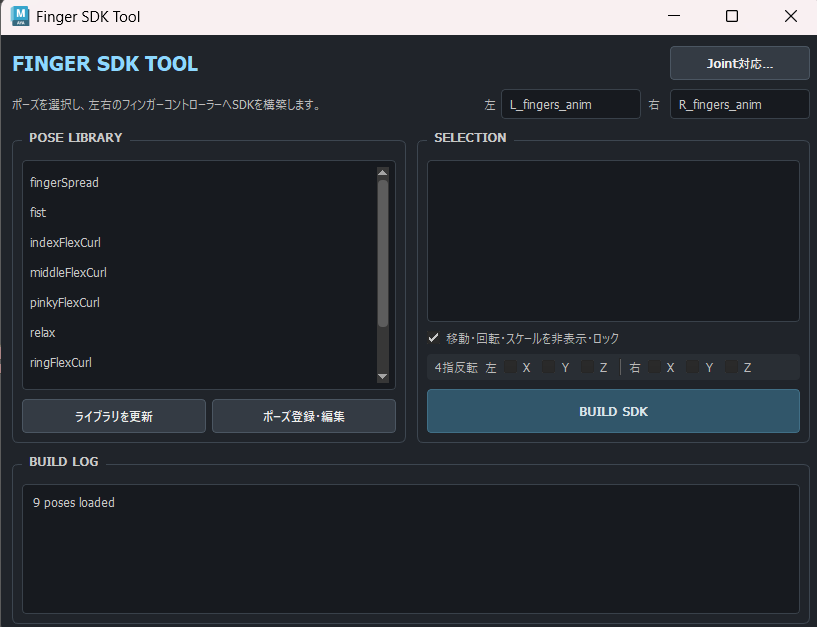
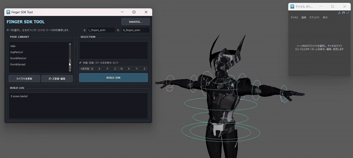
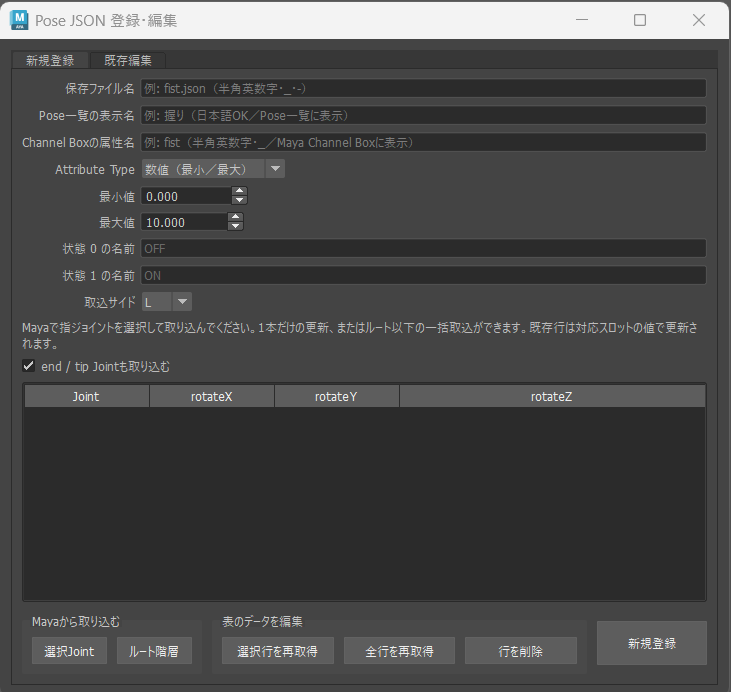
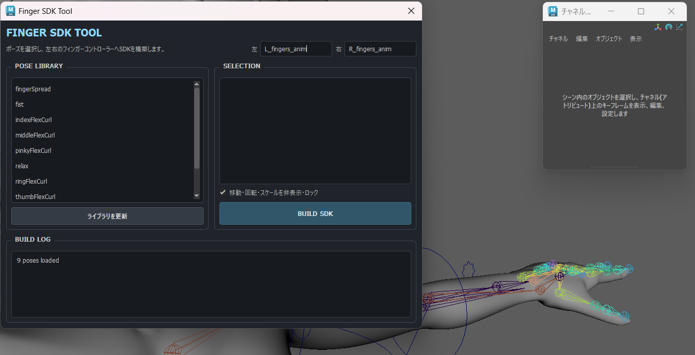
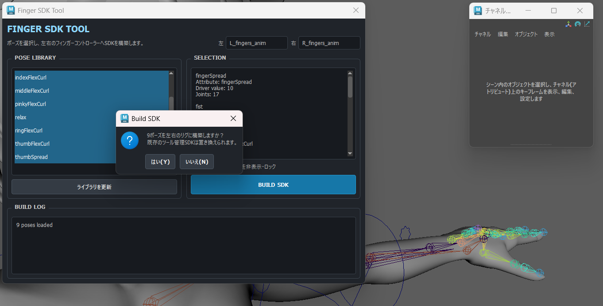
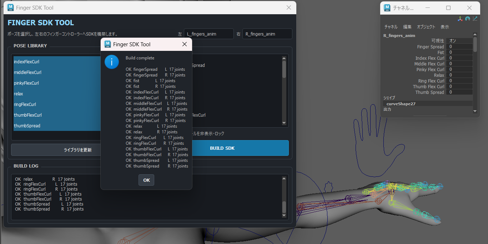
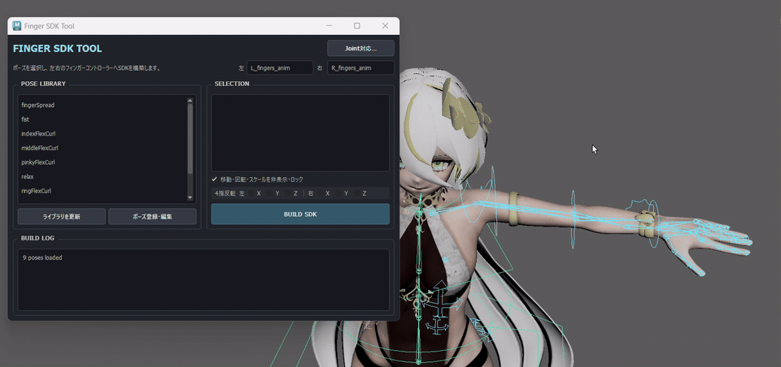
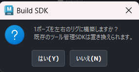
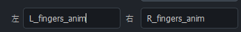

# Finger SDK Tool

[](https://github.com/Yuzuki-Midoshima/Finger-SDK-Tool/actions/workflows/ci.yml)


Autodesk Maya向けの、**指のSDK（Set Driven Key）を自動構築するリギングツール**です。



指ごとに何度も繰り返すドリブンキーの設定を自動化し、  
**ポーズデータを選んで実行するだけで、指コントローラーとSDKをまとめて構築できます。**

ポーズの数値はJSONとしてツール本体から分離しているため、Pythonコードを変更せずにポーズの追加・調整・再構築を行えます。

---

## 主な機能

- **指SDKの自動構築**  
  選択したポーズデータからドライバーアトリビュートとドリブンキーをまとめて作成します。

- **複数ポーズをまとめて構築**  
  握り / リラックス / 開閉 / 曲げなど、必要なポーズを一度に構築できます。

- **左右共通のポーズデータを使用**  
  `L_` / `R_` をツール側で判別するため、左右で同じデータを二重に管理する必要がありません。

- **ポーズ調整後の再構築**  
  既存SDKを整理してから再構築するため、調整 → 確認 → 修正を繰り返せます。

- **構築前のチェック**  
  必要なジョイントやポーズデータを確認し、不足がある場合は処理前に知らせます。

---

## 動作イメージ



多数の指ジョイントへ個別にドリブンキーを設定する代わりに、  
ツールから使用したいポーズを選択してSDKをまとめて構築します。

```text
ポーズを選択
    ↓
内容を確認
    ↓
SDKを構築
    ↓
Maya上で動作確認
    ↓
必要に応じてポーズを調整
    ↓
再構築
```

一度作って終わりではなく、  
**実際に指を動かして確認しながら何度でも調整できること**を重視しています。

---

# 機能説明

## ポーズライブラリ



指のポーズをPythonコードへ直接書き込まず、  
**JSONファイルとして管理**します。

例えば握りやリラックスなど、それぞれのポーズに対して

- 使用するドライバーアトリビュート
- ドライバーの値
- 各ジョイントの回転値

を保存します。

```json
{
  "pose_name": "fist",
  "driver_attr": "fist",
  "driver_value": 10,
  "joints": {
    "index1_jnt": {
      "rotateX": 0,
      "rotateY": 0,
      "rotateZ": -75
    }
  }
}
```

ポーズを変更するときはJSON側を編集するため、  
**SDKを構築するPython処理そのものを変更する必要がありません。**

---

## SDKの自動構築



使用したいポーズを選択し、`BUILD SDK`を実行します。



実行前に、

- ドライバーアトリビュート
- ドライバーの値
- 対象ジョイント数

などを確認できます。



構築を実行すると、

```text
指コントローラー
      ↓
ドライバーアトリビュート
      ↓
SDKカーブ
      ↓
指ジョイント
```

という接続を自動で構築します。

大量のドリブンキーをジョイントごとに手作業で設定する必要がなく、  
**同じルールで一貫した指SDKを作成できます。**

---

## 複数ポーズの一括構築

Ctrl / Shift / ドラッグによる複数選択に対応しています。

例えば、

```text
握り
リラックス
指の開閉
指の曲げ
```

などのポーズをまとめて選択し一括で構築できます。

ポーズごとに何度も同じ操作を繰り返す必要がないため、キャラクターセットアップ時の反復作業を減らせます。

---

## 左右の自動判別

ポーズデータでは、ジョイント名を

```text
index1_jnt
```

のように左右の接頭辞を付けずに記述できます。

生成時にツール側で、

```text
L_index1_jnt
R_index1_jnt
```

として解決します。

これにより左右でほぼ同じポーズデータを二重に用意する必要がなく、  
**片側だけ修正されて左右差が生まれることも防ぎやすくなります。**

---

---

## 異なるジョイント構成への対応



リグごとにジョイントの命名規則や階層構造が異なる場合でも、  
対象ジョイントを手動で指定できます。

通常は名前から対象ジョイントを自動判定しますが、  
自動判定できない場合は画面上から各指のジョイントを指定できます。

また、1つ目のジョイントを指定すると、  
その下の階層から子ジョイントを自動取得します。

親指についてはリグ構成に合わせて、

```text
自動判定
第1節から（4段）
第1関節から（3段）
```

## ポーズ調整と再構築



ポーズデータを修正したあとも、同じ操作でSDKを更新できます。

```text
既存SDK
   ↓
対象SDKを整理
   ↓
再構築
   ↓
更新されたSDK
```

構築対象に関連する既存SDKを整理してから再構築するため、  
同じポーズを繰り返し構築してもSDKカーブが重複しないようにしています。

このツールでは、

**作成 → 動作確認 → ポーズ修正 → 再構築**

という制作中の試行錯誤を前提にしています。

## コントローラー

左右のコントローラーの命名も任意で変更できます。



コントローラーは

---

# 制作背景

Finger SDKを手作業で設定する場合、  
複数の指ジョイントに対して多くのドリブンキーを設定する必要があります。

キャラクターやポーズが増えると、

- 同じ設定作業を何度も繰り返す
- 左右で設定差が発生する
- ジョイントやチャンネルの指定を間違える
- ポーズ修正のたびにSDKカーブを編集する
- キャラクター固有の数値がPythonコードへ増えていく

といった問題が起こりやすくなります。

そこで、  
**「SDKを作る処理」と「キャラクターごとのポーズ値」を分ける構成**にしました。

```text
ポーズデータ
   JSON
    ↓
データ確認
    ↓
左右・ジョイント名を解決
    ↓
共通の構築処理
    ↓
MayaのSDK
```

ポーズが変わっても構築処理は共通のまま使用できるため、  
キャラクターやポーズの追加に対応しやすくしています。

---

# 制作フロー

1. 対象のキャラクターリグをMayaで開く
2. Finger SDK Toolを起動
3. 使用したいポーズを選択
4. ドライバーアトリビュート / 値 / ジョイント数を確認
5. `BUILD SDK`を実行
6. 指コントローラーとSDKを自動構築
7. Maya上で指の動きを確認
8. 必要に応じてJSONのポーズ値を修正
9. 再度構築して更新

```text
ポーズ選択
   ↓
確認
   ↓
構築
   ↓
動作確認
   ↓
ポーズ調整
   ↓
再構築
```

---

# データと処理の分離

このツールでは、  
**キャラクター固有のポーズ値とSDK構築処理を分けています。**

```text
ポーズデータ      → JSON
データ確認        → core.py
Maya上の構築      → builder.py
画面              → main.py
```

例えば新しいポーズを追加する場合、

```text
新しいポーズ
    ↓
JSONを追加
    ↓
データ確認
    ↓
既存の構築処理
    ↓
SDK完成
```

という流れになるため、  
ポーズごとに新しいPython処理を書く必要がありません。

---

# チーム制作を想定した構成

```text
TA / プログラマー
      ↓
SDK構築処理

リガー / アーティスト
      ↓
ポーズデータ
```

ポーズを調整するために構築処理本体を直接編集する必要がないため、  
**処理ロジックとポーズ調整を分けて扱えます。**

JSONはテキスト形式なのでGit上で変更差分も確認しやすく、  
ポーズデータを共有・管理できます。

---

# 安全性

構築開始前に、

- ポーズデータ
- コントローラー
- ドライバーアトリビュート
- 使用する指ジョイント

などを確認します。

一部のジョイントが見つからない場合は不足しているジョイントを表示し、  
存在するジョイントだけで続行するか、処理を中止するか選択できます。

対象となるジョイントが1つも存在しない場合は構築を開始しません。

また、構築処理は1つのUndo処理としてまとめています。

処理中にエラーが発生した場合は、MayaのUndoを利用して  
可能な範囲で処理前の状態へ戻します。

---

# 内部構成

```text
                 Finger SDK Tool
                        │
          ┌─────────────┴─────────────┐
          │                           │
      ポーズデータ                   画面
         JSON                      main.py
          │                           │
          └─────────────┬─────────────┘
                        ↓
                     core.py
               データ確認 / 名前解決
                        ↓
                    builder.py
                  Mayaシーン操作
                    SDK構築
                        ↓
                     Mayaリグ
```

### `main.py`

- PySide画面
- ポーズ選択
- 構築確認
- 進捗表示
- 構築フロー管理

### `core.py`

- JSON読み込み
- ポーズデータ検証
- ジョイント名解決
- Mayaに依存しないデータ処理

### `builder.py`

- コントローラー生成
- ドライバーアトリビュート生成
- SDKカーブ構築
- 既存SDKの整理
- Mayaシーン操作

### `templates/`

- ポーズデータ
- キャラクター / ポーズ固有の設定値

---

# テスト

Mayaに依存しない処理を分離し、  
Pure Pythonの単体テストを実装しています。

```bash
python -m unittest discover -s tests -v
```

主に、

- JSON読み込み
- ポーズデータ検証
- ジョイント名解決
- 左右判定
- 不足ジョイント検出
- 再構築時の整理

などを確認しています。

Mayaとの統合部分については、

- コントローラー生成
- 左右構築
- 複数ポーズ構築
- SDK再構築
- カーブ重複防止
- 巻き戻し
- 1回のUndo

を実際のシーン上で確認しています。

### GitHub Actions

```text
プッシュ / プルリクエスト
        ↓
Python構文チェック
        ↓
単体テスト
        ↓
結果
```

Python 3.9 / 3.11 / 3.13で、Mayaに依存しない処理の回帰を確認しています。

---

# 技術情報

- Autodesk Maya 2022–2026
- Python 3
- maya.cmds
- PySide2 / PySide6
- JSON
- unittest
- GitHub Actions

### 主な技術要素

- JSONによるポーズデータと処理の分離
- JSONポーズデータの検証
- 左右ジョイント名の自動解決
- Set Driven Keyネットワーク構築
- 既存SDKの整理 / 再構築
- 重複しない再構築
- 1回のUndo / 巻き戻し
- Maya非依存処理の単体テスト

---

# 動作条件

- Autodesk Maya 2022–2026
- Python 3
- 対応する指ジョイント構造
- `L_` / `R_` 接頭辞を使用するリグ

外部Pythonパッケージは必要ありません。

付属のポーズデータはDiana Rigのジョイント命名を基準にしています。

```text
L_index1_jnt
R_pinky3_jnt
L_thumb_palm_jnt
```

使用するリグのジョイント名は、`templates/*.json`の定義と対応している必要があります。

---

# インストール

リポジトリをMayaのユーザースクリプトフォルダ

---

# 開発環境

- Autodesk Maya 2026
- Python 3.11
- Maya Python API
- PySide6
- shiboken6
- pytest

---

# ライセンス

MIT License

© 2026 Yuzuki Midoshima